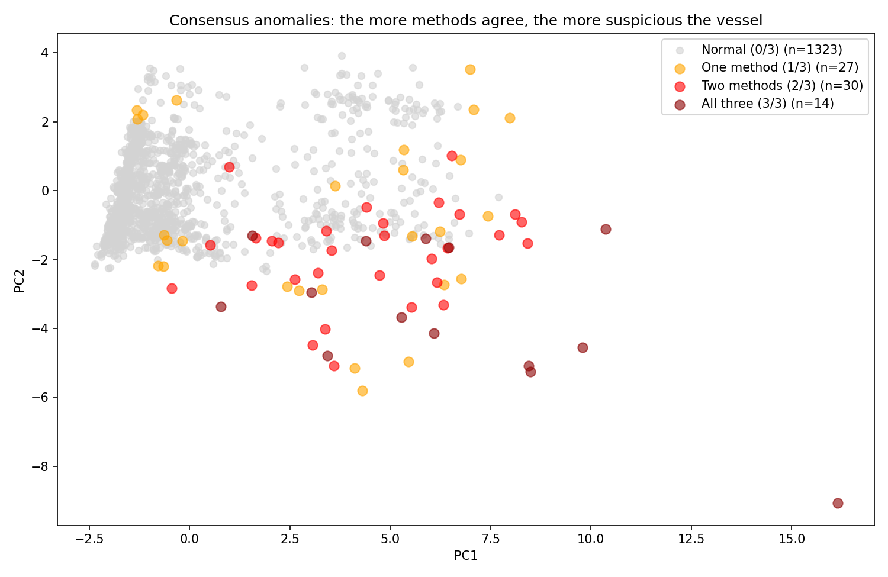

# AIS North Sea – Validating Reported Ship Types with Unsupervised Learning

In the AIS (Automatic Identification System), the crew enters the ship type by hand, while position and speed come automatically from GPS. The reported type can therefore be wrong, whether through typos, outdated settings or deliberate deception.

**Research question:** Can a ship's actual movement behaviour reveal whether its reported type is plausible?

Supervised learning is not an option, because the labels themselves (the reported types) are what is in doubt. The models therefore work purely unsupervised. The reported type is never used as a feature; it only serves as an independent reference for validation at the end.



## Data

| File | Content |
|---|---|
| `aisdk_2026_nordsee_500k.csv` | 500,000 AIS messages from the North Sea and western Baltic Sea (1 Jan 2026, approx. 1 hour), source: Danish Maritime Authority (AIS-DK) |
| `nordseehaefen.csv` | Coordinates of major North Sea ports (OpenStreetMap / Wikipedia), used to enrich the features |

## Approach

1. **Cleaning:** remove invalid GPS values (latitude = 91.0) and positions outside the area, map ship types to six categories (Cargo, Tanker, Fishing, Passenger, Sailing/Pleasure, Tug/Towing).
2. **Aggregation per ship (MMSI):** all messages of a ship are combined into a single data point, resulting in 1,394 ships with 16 features.
3. **Features:** dimensions (length, width, draught), speed statistics (SOG), course variability (COG), navigation status shares, position and spread, plus the distance to the nearest port using the haversine formula.
4. **Three anomaly detection methods:**
   - **K-Means** (k = 6): outliers based on distance to the cluster centre, threshold via IQR rule
   - **DBSCAN** (grid search over eps and min_samples): noise points are treated as outliers
   - **Isolation Forest** (hyperparameter tuning): IQR-rule threshold on the anomaly scores
5. **Consensus:** a ship is considered suspicious if at least two of the three methods flag it.
6. **Validation:** cross-tabulation of clusters vs. reported type, plausibility checks, sensitivity analysis of the IQR factor and a comparison with vs. without port data.

## Results

| Method | Silhouette | Anomalies |
|---|---|---|
| K-Means (k = 6) | 0.257 | 48 (3.4 %) |
| DBSCAN | 0.343 | 23 (1.6 %) |
| Isolation Forest | – | 58 (4.2 %) |

- **44 ships** are flagged by at least two methods, 14 of them by all three.
- For **25** of these 44 ships, the reported type does not match the dominant type of their cluster. **11** of them lie in clear-cut clusters (at least 70 % one type) – these are the strongest suspects.
- Based on behaviour alone, K-Means finds a cluster consisting of **100 % fishing vessels**.
- The most important features for anomalies are speed, draught and ship size. The external port data adds little (ranks 14 and 16 of 16).

**Limitations:** the data covers only about one hour on New Year's Day, and more than half of the ships are stationary. The suspicious cases are therefore indications, not proof of false reporting.

## Running the Notebook

Requires Python 3.11 or newer.

```bash
python3 -m venv .venv
source .venv/bin/activate
pip install -r requirements.txt
jupyter notebook AIS_Nordsee_Unsupervised_Final.ipynb
```

Both CSV files must be in the same folder as the notebook. A full run takes about two minutes. Comments and plot labels in the notebook are in German.

## Files

- `AIS_Nordsee_Unsupervised_Final.ipynb` – notebook with the complete analysis
- `requirements.txt` – required Python packages
- `images/` – figures used in this README
